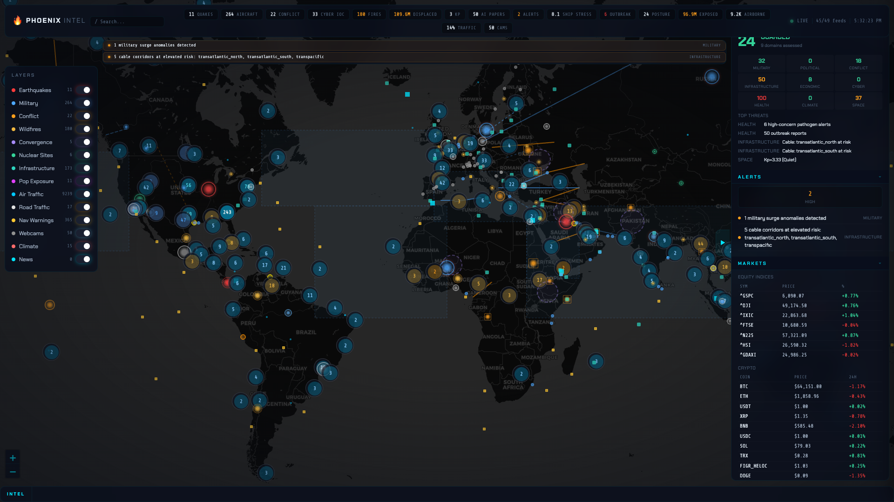

# World Intelligence MCP Server

[](https://modelcontextprotocol.io)
[](https://python.org)
[](LICENSE)

Real-time global intelligence across **30+ domains** with **160 MCP tools**, a live ops-center dashboard, a CLI, and a **Qdrant vector store** for enterprise-grade semantic search across accumulated intelligence. All data comes from free, public APIs: no paid subscriptions required.

Built for AI agents that need world awareness: market conditions, geopolitical risk, military posture, aircraft-cohort early warning, refugee and migration flows, supply chain disruptions, cyber threats, and more — all queryable via the Model Context Protocol. The vector store enables natural language queries like *"military activity near Taiwan"* or *"cyber threats targeting healthcare"* across all historical data.

For research, the collector keeps a dated history of what it captures. Each observation carries the period it describes, the publisher's release date when known, and when it was saved, so earlier copies, revised values, lagged correlations between series and any past day can be queried, and collection health is measured from the collector's run log rather than inferred from cache freshness. The server also exposes **29 MCP prompts** (worked research questions, each naming the tools it needs and the limit to respect) and **3 MCP resources**: a research guide generated from the live tool registry (`intel://guide`), a measures glossary (`intel://guide/measures`) and live source health (`intel://guide/source-health`).

---

## What You Get

| Domain | Tools | Data Sources |
|--------|-------|-------------|
| **Financial Markets** | 7 | Yahoo Finance, CoinGecko, Alternative.me, Mempool |
| **Forex & Currency** | 3 | ECB/Frankfurter (8 major pairs, timeseries, cross rates) |
| **Bonds & Yields** | 2 | FRED, Yahoo Finance (yield curve, bond ETFs, spread analysis) |
| **Earnings** | 2 | Yahoo Finance (mega-cap calendar, surprise history) |
| **SEC Filings** | 3 | SEC EDGAR (full-text search, company filings, 8-K material events) |
| **Company Enrichment** | 1 | Yahoo Finance + GDELT + SEC + GitHub (composite profile) |
| **News vs Market Reaction** | 1 | RSS story clusters + Yahoo Finance daily bars + SEC ticker file (same-session move of named companies and country indices) |
| **Macro Composite** | 1 | Weighted 6-signal market verdict (Fear&Greed, VIX, sectors, DXY, BTC, yields) |
| **Economic Indicators** | 6 | AAA fuel prices, EIA energy, FRED macro, World Bank |
| **Central Banks** | 1 | 15 central bank policy rates |
| **Liquidity and Money** | 5 | Keyless FRED graph CSV (Fed balance sheet, Treasury General Account, overnight reverse repo, US M2) and ECB Data Portal (euro area M1/M2/M3 stocks, flows and growth, Eurosystem balance sheet); derived net liquidity with its formula, unit conversion and date alignment stated |
| **BTC Technicals** | 1 | SMA 50/200, golden/death cross, Mayer Multiple |
| **Natural Disasters** | 2 | USGS earthquakes, NASA FIRMS wildfires |
| **Environmental** | 2 | NASA EONET, GDACS disaster alerts |
| **Climate** | 1 | Open-Meteo temperature/precipitation anomalies |
| **Conflict & Security** | 4 | ACLED events, UCDP, unrest detection, humanitarian data |
| **Military & Defense** | 6 | adsb.lol, OpenSky, hexdb.io, surge detection, theater posture, aircraft batch |
| **Infrastructure** | 5 | Cloudflare Radar, submarine cables, cascade analysis, cloud status, RIPEstat BGP/RPKI |
| **Maritime** | 2 | NGA navigation warnings, vessel snapshots |
| **Aviation** | 5 | FAA airport delays, domestic flight snapshot, business-jet/military cohort early warning (adsb.lol live + globe_history heatmaps) |
| **News & Media** | 3 | 119 RSS feeds (4-tier), GDELT, trending keywords |
| **News Signals** | 3 | GDELT DOC timelines (daily volume, hostile-term volume, tone) per country or pair; RSS situations ranked by coverage, hostility or change; top stories by distinct-outlet count with attention growth |
| **Intelligence Analysis** | 8 | Signal convergence, focal points, instability index, risk scores, escalation |
| **NLP Intelligence** | 4 | Entity extraction, event classification, news clustering, keyword spikes |
| **Strategic Synthesis** | 4 | Strategic posture, world brief, fleet report, population exposure |
| **Geospatial** | 11 | Military bases, ports, pipelines, nuclear facilities, cables, datacenters, spaceports, minerals, exchanges, trade routes, cloud regions |
| **AI & Technology** | 4 | arXiv papers, HuggingFace models, Hacker News, GitHub trending |
| **Cyber Threats** | 1 | Feodotracker, CISA KEV, SANS, NetAPI honeypot |
| **Health** | 1 | WHO DON, ProMED, CIDRAP disease outbreaks |
| **Space Weather** | 1 | NOAA SWPC (Kp index, solar flares, alerts) |
| **Social & Sanctions** | 3 | Reddit velocity, OFAC SDN list, nuclear test site monitoring |
| **Country Intelligence** | 3 | Country brief, country stocks, financial centers |
| **Prediction Markets** | 4 | Polymarket and Kalshi event contracts, the same event on both venues side by side with a stated match confidence, and settled markets scored against their earlier prices (Brier) |
| **Elections** | 1 | Global election calendar with risk scoring |
| **Displacement and Migration** | 7 | UNHCR refugee/IDP data, origin -> destination corridors since 1951, year-over-year surge detection; World Bank net migration and migrant stock; border crossings as flows (CBP monthly encounters, UK small-boat arrivals), never mixed with the year-end stocks |
| **Shipping** | 1 | Dry bulk shipping stress index |
| **Government** | 1 | USAspending.gov federal contracts |
| **Traffic** | 2 | Road traffic flow, real-time incidents |
| **Cross-Domain Alerts** | 2 | Alert digest, weekly trends |
| **Monitoring** | 2 | Webcams, server health/status |
| **Vector Search** | 5 | Qdrant semantic search, similarity, timeline, stats |
| **Cross-Domain Analytics** | 3 | Correlation, domain summary, trend detection |
| **Reports** | 1 | PDF/HTML multi-domain intelligence reports |
| **Daily Digest** | 1 | Cited markdown morning brief: top events, headlines, trends, and timeline |
| **AOI Geofences** | 10 | User-defined areas of interest in three shapes (circle, polygon, corridor): define/list/update/delete, a cited multi-domain brief, hotspot escalation scoring, and enter/leave change detection for a user's own area. News is scoped to the place the area sits in (OSM Nominatim reverse geocoding, no key), not to the area's name |
| **Severe Weather** | 2 | NWS active CAP alerts (US), Meteoalarm (39 EU countries) |
| **Space Launches** | 1 | Launch Library 2 upcoming launches |
| **Volcanoes** | 1 | Smithsonian GVP weekly activity report |
| **Tropical Cyclones** | 2 | NHC (Atlantic, E/C Pacific) + JTWC (NW Pacific, N Indian, S Hemisphere), with opt-in forecast tracks: positions, UTC valid times and intensities, plus NHC's cone of uncertainty |
| **Situation Brief** | 1 | Cited situational awareness brief over MCP: bounded server-side overview synthesized via local Ollama, with a mechanically-cited fallback |
| **Collection History** | 6 | Collector run log (per-source health, overdue and failing sources), saved captures with change detection and replay, dated observation series, revisions, one UTC day's timeline by collection or observation date, and on-demand backfill of the history FRED and the ECB Data Portal already serve |
| **Connections Between Series** | 1 | Correlation between stored series at leads and lags, with a minimum sample, false-discovery control and what it cannot prove |

**Total: 160 tools** across 30+ intelligence domains.

---

## Quick Start

### Install

```bash
git clone https://github.com/marc-shade/world-intel-mcp.git
cd world-intel-mcp
pip install -e .

# Optional extras
pip install -e ".[dashboard]"  # Live ops-center dashboard
pip install -e ".[vector]"     # Qdrant vector store + FastEmbed
pip install -e ".[dev]"        # pytest, respx, coverage
```

### Run as MCP Server

```bash
world-intel-mcp  # stdio mode for Claude Code, Cursor, etc.
```

### Claude Code Configuration

Add to `~/.claude.json`:

```json
{
  "mcpServers": {
    "world-intel-mcp": {
      "command": "world-intel-mcp"
    }
  }
}
```

### Dashboard

```bash
intel-dashboard              # http://localhost:8501
intel-dashboard --port 9000  # custom port
```

**Research panels** (RESEARCH in the top bar, or the `p` key): four tabs over the same functions the MCP tools call, each loaded from its own JSON route when the tab opens and refreshed every 60 s while the panel is open.

- **Liquidity board** (`/api/liquidity-board?sort=biggest_move|newest`, `fetch_liquidity_board`): latest value, units as each row states them (USD millions, USD billions, EUR millions; nothing converted), change and percent change against the previous observation, freshness and stale-cache badges, the ranking rule, unavailable indicators with their reasons, the blocked upstreams (ICI, FINRA, BLS) and the net liquidity method. Amounts outstanding are grouped apart from flows; a change between two levels is labelled as not a flow.
- **Situations** (`/api/situations?hours=&sort=&kind=`, `fetch_situations`) and **Top stories** (`/api/top-stories?hours=&min_outlets=`, `fetch_top_stories`): ranked situations or multi-outlet stories with sample headlines, the attention list, feed coverage (failed feeds named) and the functions' own definitions, method and data gaps.
- **Collection health** (`/api/collection-health`, `HistoryStore.collection_health`): state counts, then failing, degraded, not-attempted-recently and never-run sources with last attempt, last success, failures in a row, overdue and reason, storage size, and the report's `cannot_prove` text as given.

A panel that has not loaded says so; a failed call shows UNAVAILABLE with the reason (HTTP 503, or 504 after a 90 s budget) and never an empty list; a failed refresh keeps the earlier copy under a REFRESH FAILED banner with the time it loaded. Limits: the situations and top stories panels read every RSS feed: 5 to 15 s per call in the 2026-10-17 runs, warm cache included, because a feed that fails is not cached and every call tries it again, with retries, for up to 12 s. Collection health reads the history store in the dashboard's own cache database (`WORLD_INTEL_CACHE_DB`, or the default path), so it shows only cycles a collector ran against that same database; one writing elsewhere leaves every source `never_run`. These four routes send no `Access-Control-Allow-Origin` header, so a page from another site cannot read their answers; the older dashboard routes still send `Access-Control-Allow-Origin: *`, and `/api/overview` includes the cache database path. The server binds 127.0.0.1 unless `--host` says otherwise.

### PDF/HTML Reports

```bash
pip install -e ".[pdf]"      # requires: brew install pango (macOS)
intel report                 # full PDF report → ~/.cache/world-intel-mcp/
intel report --format html   # HTML (no native deps needed)
intel report -o brief.pdf    # custom output path
intel report -s markets,cyber,earthquakes  # select sections
```

Map-first ops center: Leaflet map with toggle-able layers (quakes, military, conflict, fires, convergence, nuclear, infrastructure, your AOI geofences with last-sweep counts, UNHCR migration corridors between capitals), 47 live SSE feeds, HUD bar, glassmorphic panels, per-source circuit breaker health.

### CLI

```bash
intel markets              # stock indices
intel earthquakes --min-mag 5.0
intel migration-surges     # year-over-year displacement jumps (UNHCR)
intel migration-flows -o Sudan
intel liquidity            # Fed balance sheet, TGA, RRP, net liquidity, US M2, euro area M1-M3
intel net-liquidity -n 0   # full weekly history, components and RRP date per week
intel news-reaction -c finance  # same-session moves of companies in the news
intel hostility Iran Israel --days 7   # daily hostile coverage (GDELT)
intel situations --sort change         # ranked situations (RSS)
intel top-stories -m 4                 # stories carried by 4+ outlets
intel kalshi -c Economics  # Kalshi open markets by volume
intel prediction-compare -c Economics   # same event on Kalshi and Polymarket
intel prediction-settled   # Brier scores on settled markets
intel status               # cache + circuit breaker health
intel guide                # the research guide (also served as intel://guide)
intel history health       # per-source collection health from the collector's run log
intel history connections central_bank_rates:federal_funds_rate central_bank_rates:boe_bank_rate_sonia
                           # correlation at leads and lags between stored series (day grid by default)
intel history day 2026-10-17 --by observed   # values observed on one UTC day (default: captures that day)
intel history backfill fred WALCL RRPONTSYD --start 2020-01-01  # load FRED history into the history store
intel history backfill ecb BSI.M.U2.Y.V.M30.X.1.U2.2300.Z01.E   # load ECB Data Portal history (euro area M3)
```

---

## Architecture

```
server.py     (MCP stdio) ─┐                                               ┌─ VectorStore (Qdrant)
cli.py        (Click CLI)  ├─> sources/*.py ─> Fetcher ─> CircuitBreaker ─┤
dashboard.py  (SSE)        │    analysis/*.py                              └─ Cache (SQLite)
collector.py  (daemon)    ─┘
```

- **Fetcher**: Centralized async HTTP client (httpx). Retries, per-source rate limiting, stale-data fallback. Auto-stores results in vector store on fresh fetches.
- **CircuitBreaker**: Per-source tracking. 3 consecutive failures trips for 5 minutes. Each RSS feed gets its own breaker.
- **Cache**: SQLite WAL-mode TTL cache. `get()` returns live data, `get_stale()` returns expired data for fallback.
- **VectorStore**: Qdrant + FastEmbed (BAAI/bge-small-en-v1.5, 384-dim). Async background worker queue for non-blocking storage. Enables semantic search across all accumulated intelligence.
- **Collector**: Standalone daemon that fetches all 61 sources in parallel and populates the vector store. Run once or as a daemon (default: 5-minute interval). Includes the AOI change sweep, so a running daemon continuously watches every defined geofence.
- **Sources** (`sources/*.py`): 30+ modules, each exports `async def fetch_*(fetcher, **kwargs) -> dict`.
- **Analysis** (`analysis/*.py`): Cross-domain synthesis — signal aggregation, instability indexing, NLP, company enrichment, macro composite.
- **Config** (`config/*.py`): Curated datasets — 22 hotspots, 70+ bases, 40 ports, 24 pipelines, 24 nuclear facilities, 34 cables, 48 datacenters, 27 spaceports, 82 exchanges.

---

## Research Guide: MCP Prompts and Resources

Besides its tools, the server answers the MCP `resources` and `prompts`
requests and advertises both capabilities at initialize. A connecting
model can read which tool answers which question, and what the data
cannot support, before it calls anything.

| Resource | Type | What it holds |
|----------|------|---------------|
| `intel://guide` | Markdown | How to ask a strong question (name the period, the comparison, the measure and the place), what an answer contains, what this server will not do, the worked prompts, and every tool grouped by domain. Built from the live tool registry on each read, so it always matches `tools/list`. |
| `intel://guide/source-health` | JSON | Open circuit breakers, stale serves, cache freshness per source prefix, and which keyed sources have their variables set (names only, never values). Reading it starts no fetch. Breaker state covers this server process only; the collector keeps its own. `failing_sources` names every source whose last call failed, before or after its breaker opens. A `verdict` line says when there is nothing to go on yet (no requests made and an empty cache). A cache that cannot be read is reported as `cache.available: false` with the error, next to the rest of the snapshot, and `cache.requested_path` and `cache.fell_back` show when the configured database could not be opened and a temporary one is in use. `cache.moved` is true when the cache file was moved, deleted or replaced while the server holds it open. |
| `intel://guide/measures` | Markdown | Amount outstanding versus flow, growth versus acceleration, percentage points, seasonal adjustment, observation versus publication versus collection dates, revisions, correlation and timing offsets, composite scores, and why missing data is not zero. |

**29 prompts**, each a worked research question that names the tools to
call and the limits an honest answer respects (arguments marked * are
required):

| Domain | Prompts |
|--------|---------|
| conflict | `conflict-trend` (country*, days), `hotspot-escalation` |
| markets | `market-risk-snapshot`, `yield-curve-check`, `central-bank-compare`, `fx-move` (symbol*, base, days), `company-events` (ticker*), `energy-pressure`, `crypto-structure` |
| hazards | `earthquake-exposure` (min_magnitude, hours), `severe-weather` (us_area, europe_country), `wildfire-situation` (region), `space-weather-impact` |
| migration | `displacement-history` (country*, role), `migration-surges` (year) |
| aviation | `airspace-anomaly` (cohort, region), `airport-disruption` |
| cyber | `cyber-landscape` |
| infrastructure | `internet-disruption` (country*, resource), `cloud-incidents` |
| maritime | `maritime-chokepoints` |
| aoi | `aoi-watch-setup` (name*, lat*, lon*, radius_km*), `aoi-review` (name*) |
| news | `story-breadth` (topic*) |
| politics | `election-watch` (country) |
| finance | `sanctions-screen` (query*) |
| health | `disease-watch` |
| history | `history-recall` (topic*, hours) |
| country | `country-overview` (country*) |

`prompts/get` with `conflict-trend` and `{"country": "Sudan"}` returns one
user message: the question with Sudan and the default 30-day window
filled in, the numbered tools (`intel_ucdp_events`, `intel_acled_events`,
`intel_unrest_events`) with the arguments to pass and what each call is
for, the limits (recent days are the least complete; count events and
fatalities separately; compare each source only with itself), and the
shape of a complete answer. A missing required argument, an unknown
argument, a number outside its range (latitude -90 to 90, longitude -180
to 180, an AOI radius of 1 to 2000 km), a value outside an argument's
list, a value that names a tool the prompt does not call, or an unknown
prompt is an `invalid params` error, never a guess. The tests fail if a
prompt names a tool that is not registered, passes an argument the
tool's schema does not take (wrong name, type or listed value), cites an
output field the code does not produce, describes a step in words that
share nothing with the called tool's own description, or if the guide
leaves out a registered tool. Tools that cannot work without an API key carry a
`[needs VARIABLE]` mark in the guide's tool list.

From the shell, `intel guide` prints the same guide markdown and
`intel guide --measures` prints the glossary. `intel guide` builds its
tool list from the live registry, so it opens the cache database and
creates it on first run (`~/.cache/world-intel-mcp/cache.db`, or the
path set by `WORLD_INTEL_CACHE_DB` or `XDG_CACHE_HOME`). Starting the CLI
at all, `intel --help` and `intel guide --measures` included, creates
`~/.cache/world-intel-mcp/temporal.db` under your home directory.

---

## MCP Tools Reference

### Financial Markets (7)
| Tool | Description |
|------|-------------|
| `intel_market_quotes` | Stock index quotes (S&P 500, Dow, Nasdaq, FTSE, Nikkei) |
| `intel_crypto_quotes` | Top crypto prices and market caps from CoinGecko |
| `intel_stablecoin_status` | Stablecoin peg health (USDT, USDC, DAI, FDUSD) |
| `intel_etf_flows` | Bitcoin spot ETF prices and volumes |
| `intel_sector_heatmap` | US equity sector performance (11 SPDR ETFs) |
| `intel_macro_signals` | 7 macro signals: Fear & Greed, Bitcoin mempool fees, DXY, VIX, gold, 10Y Treasury yield, BTC dominance |
| `intel_commodity_quotes` | Commodity futures (gold, silver, crude, natgas, grains) |

### Forex & Currency (3)
| Tool | Description |
|------|-------------|
| `intel_forex_rates` | Latest FX rates from ECB. Filter by base/target currencies |
| `intel_forex_timeseries` | Historical FX rate with trend analysis (configurable days) |
| `intel_major_crosses` | All 8 major pairs + cross rates + DXY proxy |

### Bonds & Yields (2)
| Tool | Description |
|------|-------------|
| `intel_yield_curve` | US Treasury yield curve (2Y-30Y), 2s10s/3m10y spreads, inversion flag |
| `intel_bond_indices` | Bond ETFs: AGG, TLT, HYG, LQD, TIP with price/change |

### Earnings (2)
| Tool | Description |
|------|-------------|
| `intel_earnings_calendar` | Upcoming earnings for 20 mega-cap stocks with EPS estimates |
| `intel_earnings_surprise` | Historical earnings surprise (actual vs estimate, trend) |

### SEC Filings (3)
| Tool | Description |
|------|-------------|
| `intel_sec_filings` | Full-text search across all EDGAR filings |
| `intel_company_filings` | Company filings by ticker (10-K, 10-Q, 8-K) with CIK resolution |
| `intel_recent_8k` | Latest 8-K material events (M&A, exec changes, earnings) |

### Company Enrichment (1)
| Tool | Description |
|------|-------------|
| `intel_company_profile` | Composite profile: stock quote + financials + news + SEC + GitHub |

### News vs Market Reaction (1)
| Tool | Description |
|------|-------------|
| `intel_news_market_reaction` | Companies and countries named in recent story clusters, mapped to tickers from the entity table (US tickers annotated with their SEC registrant) and country indices; the move on the story's market session (stock, benchmark, excess return; index return with a trailing z-score). After-close stories map to the next session, weekends and holidays to the next trading day, in the exchange's timezone; a session not yet closed or not yet final is pending. Unmapped and ambiguous names are listed with reasons; a failed quote or an expired cached copy is a data gap, never 0%. Co-movement, not causation; not a trading signal |

### Macro Composite (1)
| Tool | Description |
|------|-------------|
| `intel_macro_composite` | Weighted market score (0-100) with verdict: RISK_ON to STRONG_CAUTION |

### Economic (6)
| Tool | Description |
|------|-------------|
| `intel_gas_prices` | Daily US retail gasoline, diesel, and E85 prices from AAA |
| `intel_residential_natgas` | US residential natural gas prices from EIA |
| `intel_electricity_rates` | US electricity retail rates by sector/state from EIA |
| `intel_energy_prices` | Brent/WTI crude oil and natural gas from EIA |
| `intel_fred_series` | FRED economic data (GDP, CPI, unemployment, rates) |
| `intel_world_bank_indicators` | World Bank development indicators by country |

### Central Banks (1)
| Tool | Description |
|------|-------------|
| `intel_central_bank_rates` | Policy rates for 15 major central banks |

### Liquidity and Money (5)
Keyless: FRED graph CSV and the ECB Data Portal. Every point carries its observation date, value and units; every series is typed `amount_outstanding`, `flow`, `growth_rate`, `index` or `unknown`, and carries a freshness block (age of the newest observation against its publication cadence). `limit=0` returns the full history. A failed upstream is an error or an `unavailable` row, never a zero.

| Tool | Description |
|------|-------------|
| `intel_liquidity_board` | Latest reading and change vs the previous observation for the Fed balance sheet, TGA, overnight reverse repo, net liquidity, US M2, euro area M1/M2/M3 and Eurosystem total assets; sort by `biggest_move` (absolute change in billions of each row currency, no FX conversion; horizons differ) or `newest`; a `blocked` list names the measures not covered (ICI fund flows and ETF net issuance, FINRA margin statistics, BLS) with the upstream status measured, and no proxy stands in for them |
| `intel_net_liquidity` | Weekly WALCL minus WDTGAL minus RRPONTSYD in USD billions (millions divided by 1,000), aligned on the WALCL Wednesday; each point names its components and the RRP date used; unaligned weeks are skipped and counted; a `method` block states each term's observation basis, units, conversion and RRP alignment |
| `intel_money_supply` | US M2 (FRED M2SL) and euro area M1, M2, M3 (ECB BSI stocks, monthly flows, annual growth rates), reported separately and never summed; US M3 is reported as discontinued |
| `intel_fed_liquidity_series` | One FRED liquidity series (WALCL, WDTGAL, WTREGEN, RRPONTSYD, M2SL) with full history; blank source dates are counted, not read as zero |
| `intel_ecb_series` | ECB Data Portal series by SDMX key from BSI (monetary aggregates) or ILM (Eurosystem weekly financial statement), with units, scale and provisional flags from the response |

### BTC Technicals (1)
| Tool | Description |
|------|-------------|
| `intel_btc_technicals` | Bitcoin SMA 50/200, golden/death cross, Mayer Multiple |

### Natural Disasters (2)
| Tool | Description |
|------|-------------|
| `intel_earthquakes` | USGS earthquakes (configurable magnitude/time/limit) |
| `intel_wildfires` | NASA FIRMS satellite fire hotspots (9 global regions) |

### Environmental (2)
| Tool | Description |
|------|-------------|
| `intel_environmental_events` | NASA EONET natural events |
| `intel_disaster_alerts` | GDACS disaster alerts with severity scoring |

### Conflict & Security (4)
| Tool | Description |
|------|-------------|
| `intel_acled_events` | ACLED armed conflict events |
| `intel_ucdp_events` | Uppsala Conflict Data Program events |
| `intel_unrest_events` | Social unrest with Haversine dedup |
| `intel_humanitarian_summary` | HDX humanitarian crisis datasets |

### Military & Defense (6)
| Tool | Description |
|------|-------------|
| `intel_military_flights` | Military aircraft via adsb.lol (OpenSky fallback) |
| `intel_theater_posture` | Activity across 5 theaters (EU, Indo-Pacific, ME, Arctic, Korea) |
| `intel_aircraft_details` | Aircraft lookup by ICAO24 hex (hexdb.io) |
| `intel_aircraft_batch` | Batch aircraft lookup (multiple hex codes) |
| `intel_military_surge` | Foreign aircraft concentration anomaly detection |
| `intel_usni_fleet` | USNI News naval fleet tracker |

### Infrastructure (5)
| Tool | Description |
|------|-------------|
| `intel_internet_outages` | Cloudflare Radar internet disruptions |
| `intel_cable_health` | Submarine cable corridor health |
| `intel_cascade_analysis` | Infrastructure cascade simulation |
| `intel_service_status` | Cloud platform health (AWS, Azure, GCP, Cloudflare, GitHub) |
| `intel_bgp_status` | RIPEstat BGP status for one prefix or ASN: RIS peer visibility, origin ASNs, RPKI validity (a per-resource health check, not global hijack detection) |

### Maritime (2)
| Tool | Description |
|------|-------------|
| `intel_nav_warnings` | NGA maritime navigation warnings |
| `intel_vessel_snapshot` | Naval activity at 9 strategic waterways |

### Geospatial Datasets (10)
| Tool | Description |
|------|-------------|
| `intel_military_bases` | 70 military bases from 9 operators |
| `intel_strategic_ports` | 40 strategic ports across 6 types |
| `intel_pipelines` | 24 oil/gas/hydrogen pipelines |
| `intel_nuclear_facilities` | 24 nuclear power/enrichment/research facilities |
| `intel_undersea_cables` | 34 submarine communications cables |
| `intel_ai_datacenters` | 48 AI/HPC datacenters worldwide |
| `intel_spaceports` | 27 global spaceports |
| `intel_critical_minerals` | 27 strategic mineral deposits |
| `intel_stock_exchanges` | 82 stock exchanges worldwide |
| `intel_trade_routes` | Major trade routes and chokepoints |

### News & Media (3)
| Tool | Description |
|------|-------------|
| `intel_news_feed` | 119 global RSS feeds with 4-tier source ranking |
| `intel_trending_keywords` | Trending terms with spike detection |
| `intel_gdelt_search` | GDELT 2.0 global news search |

### News Signals (3)
| Tool | Description |
|------|-------------|
| `intel_hostility_timeline` | Per-day GDELT coverage of a country or a pair: article count, articles using threat / sanction / force / criticism terms (GDELT keyword match, terms listed in the response), average tone. A failed call, an expired cached copy, or a day GDELT did not return is null and listed in `data_gaps` (`column_status` per call), never zero; partial days are flagged per column |
| `intel_situations` | Situations between countries (headlines naming two or more) and inside a country (headlines naming one), ranked by most covered, most hostile (headline keyword heuristic) or biggest change against the prior window; the response defines each measure and names the feeds excluded from change figures. With no comparable feed, change is null and `change_measured` false |
| `intel_top_stories` | Stories carried by at least `min_outlets` distinct outlets (sister feeds of one publisher count once), plus the countries and organizations whose headline mentions grew most (`attention_change_measured` false when nothing could be compared) |

### Intelligence Analysis (8)
| Tool | Description |
|------|-------------|
| `intel_signal_convergence` | Geographic convergence of multi-domain signals |
| `intel_focal_points` | Multi-signal focal point detection |
| `intel_signal_summary` | Country-level signal aggregation |
| `intel_temporal_anomalies` | Activity deviations from baselines |
| `intel_instability_index` | Country Instability Index v2 (0-100) |
| `intel_risk_scores` | ACLED-based conflict risk scoring |
| `intel_hotspot_escalation` | Escalation scores for 22 intel hotspots |
| `intel_country_dossier` | Comprehensive country intelligence dossier |

### NLP Intelligence (4)
| Tool | Description |
|------|-------------|
| `intel_extract_entities` | Named entity extraction (countries, leaders, orgs, CVEs, APTs) |
| `intel_classify_event` | Event classification into 14 threat categories |
| `intel_news_clusters` | Topic clustering by Jaccard similarity, with each cluster's distinct-outlet count |
| `intel_keyword_spikes` | Keyword spike detection with Welford's algorithm |

### Strategic Synthesis (4)
| Tool | Description |
|------|-------------|
| `intel_strategic_posture` | Composite global risk from 9 weighted domains |
| `intel_world_brief` | Structured daily intelligence summary |
| `intel_fleet_report` | Naval fleet activity report with readiness scoring |
| `intel_population_exposure` | Population at risk near active events (105-city dataset) |

### Climate (1)
| Tool | Description |
|------|-------------|
| `intel_climate_anomalies` | Open-Meteo temperature/precipitation anomalies |

### Prediction Markets (4)
| Tool | Description |
|------|-------------|
| `intel_prediction_markets` | Polymarket prediction contracts |
| `intel_kalshi_markets` | Kalshi open markets from its public market data (no account), ranked by volume; YES implied probabilities with the venue's units stated; filter by category or series. Says which events it scanned and whether the scan was complete. Data served from an expired cache entry after a failed fetch is marked `stale` and `degraded`, with its age |
| `intel_prediction_compare` | The same event on Kalshi and Polymarket: deterministic matching (quantities, years, end dates, negation, rate actions such as cut/raise/hold, directions such as above/below, and outcome side must agree), a `match_confidence` with reasons per pair, the price gap, the closest rejected pairs and why, and unmatched counts per venue. `match_confidence` is an ordinal score for ranking pairs, not a probability that two markets are the same event. Each side names its price basis, spread and last-trade time; a pair is flagged and listed after comparable ones when either side has no price, is not a two-sided quote midpoint, comes from an expired cached copy served after a failed live fetch, or has a spread wider than 0.10, when the two venues' thresholds differ at the boundary (strict on one, inclusive on the other), or when a looked-up Kalshi last trade differs from the listing's last price |
| `intel_prediction_settled` | Settled markets on both venues with the outcome, the YES price at fixed offsets before close, and a Brier score per venue and offset with sample size, distinct events, selection and exclusions. A venue without price history is not scored, and a price history served from expired cache is excluded. Reference times differ by venue (Kalshi `close_time`; Polymarket the earlier of `endDate` and `closedTime`), so the two scores are not a head-to-head comparison. Polymarket's price histories share the `polymarket` circuit breaker with `intel_prediction_markets`: three failed history calls pause every Polymarket read for the breaker's 300 s cooldown |

### Elections (1)
| Tool | Description |
|------|-------------|
| `intel_election_calendar` | Global election calendar with risk scoring |

### Displacement and migration (7)
| Tool | Description |
|------|-------------|
| `intel_displacement_summary` | UNHCR refugee/IDP statistics, top 30 origins |
| `intel_migration_flows` | UNHCR origin -> destination corridors (country or region filters), with change vs the prior year |
| `intel_migration_surges` | Largest year-over-year increases and decreases by origin and corridor, plus IDPs, sized against population |
| `intel_migration_history` | One country's yearly series since 1951 as an origin or a host, with its peak and largest waves |
| `intel_net_migration` | World Bank net migration and migrant stock: latest ranking, regions, or one country since 1960 |
| `intel_us_border_encounters` | CBP encounters per month over the four fiscal years in CBP's newest file (from October 2022 as of October 2026; apprehensions, inadmissibles, Title 42 expulsions): nationwide or by land border region, by component and citizenship, with same-month prior-year change and fiscal-year totals. Events, not unique people |
| `intel_uk_small_boat_arrivals` | Home Office daily and weekly small-boat arrivals across the English Channel (migrants, boats, uncontrolled landings) with French-reported preventions, month and year sums, and year to date vs last year. Provisional operational data |

### Aviation (5)
| Tool | Description |
|------|-------------|
| `intel_airport_delays` | FAA airport delay status |
| `intel_aviation_domestic` | Global air traffic snapshot from OpenSky |
| `intel_jet_cohort_snapshot` | Live airborne business-jet (ICAO type designators) or military cohort from adsb.lol; learns cohort membership as a side effect |
| `intel_jet_activity_anomaly` | Peak concurrent airborne cohort aircraft in a UTC half-hour vs the same slot on prior same-weekday dates (holiday-adjacent dates swapped out); robust z, alert level 1-5, deficit flag |
| `intel_jet_excess_origins` | Infers takeoffs/landings from heatmap tracks, density-clusters endpoints, and reports clusters above their baseline median: departure/arrival anchor, regional, or diffuse |

**Cohort early warning.** The three `intel_jet_*` tools watch a cohort of aircraft
(business jets by ICAO type designator, or military) for activity that departs
from its calendar baseline, and locate where an excess came from. Data:
adsb.lol's live API and its public half-hour `globe_history` heatmaps (readsb
format, ODbL 1.0, no key). Heatmaps are ~14 MB each and immutable once
published, so they are cached on disk next to the cache DB
(`WORLD_INTEL_HEATMAP_CACHE_MB`, default 1024) and fetched at most one at a
time with a 2 s floor. The cohort is *learned* from live snapshots (run
`intel_jet_cohort_snapshot` or the collector daemon, which now includes
`bizjet_cohort` and `military_cohort`); the analyses only use members first
seen `min_learning_lead_hours` (default 24) before the window, because a
cohort learned during a window inflates that window (measured: 1,002 vs a
206 baseline median when the gate is bypassed). Until the cohort has that
lead, the tools answer `warming_up`. The baseline is a handful of
same-weekday slots fetched on demand, not a year-long backfill, so there
are no learned holiday profiles or annual ratios.

Approach inspired by [kylemcdonald/ews](https://github.com/kylemcdonald/ews)
(Early Warning System: business-jet cohorts against calendar baselines, and
the excess-origin detector). This is an independent implementation over a
different, openly licensed data source; no ews code is used.

### Cyber Threats (1)
| Tool | Description |
|------|-------------|
| `intel_cyber_threats` | Aggregated cyber intel (Feodo, CISA KEV, SANS, NetAPI honeypot) |

### Space Weather (1)
| Tool | Description |
|------|-------------|
| `intel_space_weather` | Solar activity (Kp index, X-ray flux, SWPC alerts) |

### AI & Technology (4)
| Tool | Description |
|------|-------------|
| `intel_ai_releases` | arXiv AI papers, HuggingFace models |
| `intel_hacker_news` | Hacker News top stories |
| `intel_trending_repos` | GitHub trending repositories |
| `intel_arxiv_papers` | arXiv paper search |

### Health (1)
| Tool | Description |
|------|-------------|
| `intel_disease_outbreaks` | WHO DON, ProMED, CIDRAP outbreaks |

### Social & Sanctions (3)
| Tool | Description |
|------|-------------|
| `intel_social_signals` | Reddit geopolitical discussion velocity |
| `intel_sanctions_search` | OFAC SDN list search |
| `intel_nuclear_monitor` | Seismic monitoring near nuclear test sites |

### Shipping & Trade (1)
| Tool | Description |
|------|-------------|
| `intel_shipping_index` | Dry bulk shipping stress index |

### Government (1)
| Tool | Description |
|------|-------------|
| `intel_usa_spending` | USAspending.gov federal contracts |

### Country Intelligence (3)
| Tool | Description |
|------|-------------|
| `intel_country_brief` | Quick country situation summary |
| `intel_country_stocks` | Stock exchanges and listings by country |
| `intel_financial_centers` | Global financial centers ranking |

### Extended Geospatial (1)
| Tool | Description |
|------|-------------|
| `intel_cloud_regions` | Cloud provider regions worldwide |

### Traffic (2)
| Tool | Description |
|------|-------------|
| `intel_traffic_flow` | Road traffic flow data |
| `intel_traffic_incidents` | Real-time traffic incidents |

### Cross-Domain Alerts (2)
| Tool | Description |
|------|-------------|
| `intel_alert_digest` | Cross-domain alert aggregation |
| `intel_weekly_trends` | Weekly trend analysis |

### Monitoring (2)
| Tool | Description |
|------|-------------|
| `intel_webcams` | Public webcam locations and live previews |
| `intel_status` | Server health, cache stats, circuit breaker status |

### Vector Search (5)
| Tool | Description |
|------|-------------|
| `intel_semantic_search` | Natural language search across all accumulated intelligence |
| `intel_similar_events` | Find events similar to a given data point |
| `intel_timeline` | Chronological view of intelligence for a domain/category |
| `intel_vector_stats` | Vector store collection statistics |
| `intel_collect` | Trigger an on-demand collection cycle |

### Cross-Domain Analytics (3)
| Tool | Description |
|------|-------------|
| `intel_cross_correlate` | Find correlated signals across all domains for a given topic |
| `intel_domain_summary` | Per-category summary of stored intelligence (counts, sources, recency) |
| `intel_trend_detection` | Detect activity surges/drops by comparing recent vs baseline periods |

### Reports (1)

| Tool | Description |
|------|-------------|
| `intel_generate_report` | Generate a PDF or HTML intelligence report covering 18 domains in parallel |

### AOI Geofences (10)
| Tool | Description |
|------|-------------|
| `intel_aoi_define` | Define a named area of interest: point + radius in km (1-2000) |
| `intel_aoi_define_polygon` | Define a polygon AOI from 3-64 [lat, lon] vertices (a border region, a strait, an EEZ) |
| `intel_aoi_define_corridor` | Define a corridor AOI: 2-64 waypoints plus a width in km (a shipping lane, supply road, cable run) |
| `intel_aoi_update` | Rename any AOI, or change a circle AOI's center/radius in place (a polygon or corridor can only be renamed; to change its shape, delete and redefine it). A rename keeps its change history; an actual change to center or radius resets it, because the old baseline described a different area |
| `intel_aoi_list` | List all user-defined AOIs |
| `intel_aoi_delete` | Delete a user-defined AOI by name |
| `intel_aoi_brief` | Cited brief for an AOI: earthquakes, military flights, wildfires, ACLED conflict events and sampled aviation inside the AOI's exact shape (circle, polygon or corridor); nearby static infrastructure with distances in km (for polygon and corridor AOIs, point sites are refined to the shape and pipelines and cables match the bounding circle, noted in `data_gaps`); and news for the settlement and county at the AOI's center (OSM Nominatim reverse geocoding), falling back to the AOI's name, noted in `data_gaps`, when no place is found. Every item carries a [n] citation; `data_gaps` names each domain that could not be scoped |
| `intel_aoi_escalation` | Hotspot escalation scoring (same engine as the 22 built-in hotspots) applied to a user AOI |
| `intel_aoi_changes` | What entered or left an AOI since the last sweep (earthquakes, military flights, ACLED events, wildfire clusters, news); the first call sets a baseline |
| `intel_aoi_digest` | One change sweep across every AOI (or a named subset) with a combined markdown digest; a scheduler can call it on an interval |

### Daily Digest (1)
| Tool | Description |
|------|-------------|
| `intel_daily_digest` | Cited markdown morning brief: top events by domain, recent headlines, and (with the vector store) trends and a 24h timeline; every item carries a [n] citation |

### Severe Weather (2)
| Tool | Description |
|------|-------------|
| `intel_weather_alerts` | US National Weather Service active CAP alerts (US only) |
| `intel_meteoalarm_alerts` | Meteoalarm severe-weather warnings for 39 European countries (per-country feeds) |

### Tropical Cyclones (2)
| Tool | Description |
|------|-------------|
| `intel_cyclones` | NHC active storms: Atlantic, Eastern and Central Pacific. `include_forecast` adds each storm's forecast track (from its forecast/advisory) and a simplified 5-day cone outline |
| `intel_jtwc_cyclones` | JTWC warnings: Northwest Pacific, North Indian Ocean, Southern Hemisphere. `include_forecast` adds each storm's forecast track from its warning text (JTWC publishes no cone) |

### Space Launches (1)
| Tool | Description |
|------|-------------|
| `intel_launch_schedule` | Upcoming rocket launches from Launch Library 2 (cached 1 h for the free tier) |

### Volcanoes (1)
| Tool | Description |
|------|-------------|
| `intel_volcano_activity` | Smithsonian GVP / USGS Weekly Volcanic Activity Report (weekly, curated) |

### Situation Brief (1)
| Tool | Description |
|------|-------------|
| `intel_situation_brief` | Cited situational awareness brief, generated on demand over MCP: a bounded server-side overview (earthquakes, military flights, ACLED conflict events, wildfires, cyber threats, disease outbreaks, news, space weather, strategic posture, alert digest), synthesized via local Ollama or a mechanically-cited fallback when Ollama is unreachable |

### Collection History (6)
History accrues only while the collector (`intel-collector`) runs; nothing before its first recorded cycle exists, except what a backfill loads (`intel_history_backfill`, `intel history backfill`): FRED graph CSV and ECB Data Portal series, stored under `backfill:fred` and `backfill:ecb` with the publisher's current vintage, so revisions made before the first backfill are invisible. Every observation keeps three dates: `observed_at` (the period the value describes, from the payload, or null when the payload has none), `published_at` (publisher release, when known) and `collected_at` (when this server saved it). A run answered from an expired cached copy is recorded as a stale-cache replay: it never counts as a success, and its observations are not stored, because a replay is not a new observation.

| Tool | Description |
|------|-------------|
| `intel_collection_health` | Per-source health from the collector's run log: last attempt, last live success (a source served from stale cache reads `stale` and goes overdue), last fully ok capture, consecutive failures, overdue against the expected cadence, never-run sources, lost history writes, history storage size; states its data gaps and what it cannot prove (a fresh capture does not mean upstream observations are current) |
| `intel_capture_history` | A source's earlier captures (ok / degraded / error with reason, such as `served stale cache`, duration, record count) and whether each changed from the previous one; `capture_id` replays one stored payload (an outline of its keys past the replay cap) |
| `intel_series_history` | One series' observations with all three dates, or the list of available series |
| `intel_revisions` | Values for the same `observed_at` that a later capture changed (USGS magnitude revisions, NOAA Kp updates), with how many observations and dated series were checked |
| `intel_day_timeline` | What the history store holds for one UTC day (`YYYY-MM-DD`; a future day is an error). `by=collected` (default): per source, that day's captures (attempts, ok / degraded / error with reasons, changed vs unchanged payloads, first and last capture, observations stored), and extractor failures and partial failures, and for a source with no capture whether the collector did not run that day, ran without it, never ran it, the day is before the run log starts, or it is past run-log retention. `by=observed`: values whose `observed_at` falls on the day; month and year values containing the day are listed apart as period values, and undated observations are counted and excluded. Every item carries `observed_at`, `published_at` and `collected_at`; pruned records are named, never read as a quiet day; per-source and total caps (shared by both by=observed lists) with truncation disclosed. Read-only, one snapshot per call, never fetches |
| `intel_history_backfill` | Load the history FRED (graph CSV) or the ECB Data Portal already serve into the history store: one capture per request (a FRED id, or an ECB key that may match several series) under `backfill:fred` / `backfill:ecb`, `observed_at` from the publisher's dates, `published_at` null, `collected_at` the backfill time; re-runs store only new or changed values (a change is a revision); FRED missing values skipped and counted, ECB missing values not countable (null); writes and fetches, so capped at 5 FRED series or 2 ECB keys per call |

### Connections Between Series (1)
Reads the history store only, so the sample is what the collector saved, not each series' full history. A connection is a correlation in that sample: it does not show causation, and a lead does not show causal direction.

| Tool | Description |
|------|-------------|
| `intel_lagged_connections` | Correlation between 2 to 8 stored series (keys as `intel_series_history` lists them) on a UTC day, week or month grid, tested at every lag from `-max_lag` to `+max_lag` (default 5, at most 30, at most 1,000 tests a call). Default transform is period-over-period changes, because levels of trending series correlate spuriously; `levels` on request. Per pair: the lag with the smallest p, with Pearson r, overlap n, two-sided p from Student's t (periods treated as independent), `p_ar1` recomputed with an AR(1) effective sample size from both series' lag-1 autocorrelations, and the Benjamini-Hochberg `q` and `q_ar1` across every test in the call. `significant` means `q_ar1` <= 0.05 by default (`significant_if_independent` applies the threshold to `q`); an effective sample under 3 is reported as no evidence, and `data_gaps` names autocorrelated series and pairs where serial correlation dominates. Lag +k compares A at period t with B at t+k, so A leads B by k. Pair/lag overlaps under `min_overlap` points (default 30, clamped to 20..3,000; `--min-overlap` in the CLI) are listed as not tested with their n; revised points use the latest vintage; rows without `observed_at` (Yahoo quotes) are not used; every clamped input is reported, in the CLI too |

---

## Watching your own area (geofences/AOIs)

Static infrastructure results (bases, ports, nuclear, cables, datacenters, spaceports) draw on this repo's curated strategic datasets, which are global and deliberately sparse, not exhaustive local registries. A quiet AOI brief means nothing from those curated sets is in range, not that your area has no infrastructure.

Before the AOI family, only `intel_signal_convergence` accepted a real
point-plus-radius, `intel_military_flights` took a bbox, and hotspot
escalation scoring was restricted to the 22 hardcoded `INTEL_HOTSPOTS`.
The `intel_aoi_*` tools let you name your own area (a city, a border
region, a facility) and get the same cited, multi-domain treatment.
Geofences survive the antimeridian (a Bering Strait or Fiji AOI queries
both sides of the dateline), and pipelines/undersea cables are matched
as line features via great-circle segment distance, not just by their
endpoints.

Define an AOI once, then brief, score, edit, and watch it. Three
shapes: a circle (point + radius), a polygon (3-64 vertices, for a
border region or strait a radius cannot express), or a corridor (a
waypoint route + width, for a shipping lane or supply road):

```
intel_aoi_define(name="Pittsburgh", lat=40.4406, lon=-79.9959, radius_km=50)
intel_aoi_define_polygon(name="Taiwan Strait", vertices=[[22.5, 118.0], [22.5, 121.5], [26.5, 122.0], [26.5, 118.5]])
intel_aoi_define_corridor(name="Suez Approach", waypoints=[[29.9, 32.55], [27.5, 34.0], [24.0, 36.0]], width_km=80)
intel_aoi_brief(name="Taiwan Strait")
intel_aoi_escalation(name="Pittsburgh")
intel_aoi_update(name="Pittsburgh", radius_km=100)   # resize/rename in place
intel_aoi_changes(name="Suez Approach")  # what entered/left since last sweep
intel_aoi_digest()  # one-call sweep across ALL your areas
```

The same nine operations are available from the terminal: `intel aoi define|define-polygon|define-corridor|list|update|delete|brief|escalation|changes`.

Membership is exact for the shape (an event inside a polygon's
bounding circle but outside the polygon is excluded); corridor
distances are measured to the route. Line-feature infrastructure
(pipelines, undersea cables) matches the bounding circle for
non-circle shapes, disclosed in `data_gaps`.

`intel_aoi_changes` is the alerting primitive: the first call records a
baseline, and every later call reports what entered and left the fence
per domain, with failed fetches reported as `data_gaps` rather than
counted as departures.

`intel_aoi_brief` filters every geo-capable domain to the 50 km radius
around Pittsburgh: earthquakes, military flights (bbox derived from the
radius), wildfires (region-mapped, since NASA FIRMS has no point+radius
query), ACLED conflict events, a sample of nearby aviation traffic,
nearby static infrastructure (military bases, ports, pipelines, nuclear
facilities, undersea cables, datacenters, spaceports) with distances in
km, and news about the place at the AOI's centre (the reverse-geocoded
settlement and county, here Pittsburgh). Every item in the
response carries a `[n]` citation into a numbered `sources` list, and
`data_gaps` names any domain that couldn't be scoped to the AOI (for
example, wildfires when the AOI falls outside NASA FIRMS's coverage
regions, or conflict events when ACLED credentials aren't configured)
instead of silently omitting it.

`intel_aoi_escalation` runs the same baseline/military/conflict/social-
unrest scoring engine that powers `intel_hotspot_escalation` for the 22
built-in hotspots, but scoped to your AOI's own radius instead of a fixed
2-degree window. An AOI has no curated baseline, so that component is 0
and the score tops out at 80; `score_ceiling` gives this call's ceiling,
lower when a component is missing or zero-filled. It also scores the two
components the built-ins leave null. News is the change in the area's
share of all GDELT coverage, the 7 days ending with GDELT's current
(still filling) daily step against the 7 before, for the reverse-geocoded
settlement and county at the AOI's centre (the same query the brief
uses), so a swing or outage in what GDELT ingests is not read as a news
surge; only a rise scores. Convergence runs the multi-domain convergence
grid, laid at four half-degree offsets so a compact cluster on a degree
line is not split, over the earthquakes, military flights, ACLED events
and wildfires inside the AOI's exact shape. A source that did not answer,
or answered only with an expired cached copy, counts as missing, never as
quiet, and a global sample that hit its cap counts as partial. If either
component's inputs fail, it comes back null with the reason in
`data_gaps`, never as a 0, and `computed_from` names the components the
score was computed from (`zero_filled_components` flags any that are a 0
only because the military or ACLED fetch failed, and
`lower_bound_components` any that partial data can only have
understated).

AOIs persist in a dedicated table inside the same SQLite cache database
the server already uses (`$WORLD_INTEL_CACHE_DB` when set, otherwise
`$XDG_CACHE_HOME/world-intel-mcp/cache.db`, falling back to
`~/.cache/world-intel-mcp/cache.db`), so a scheduled agent can watch any named
area across restarts with `intel_aoi_list` / `intel_aoi_delete` to manage
them.

Temporal and keyword spike baselines use `temporal.db` and
`keyword_spikes.db` in `$XDG_CACHE_HOME/world-intel-mcp/`, or
`~/.cache/world-intel-mcp/` when `XDG_CACHE_HOME` is unset.
`WORLD_INTEL_CACHE_DB` only overrides the main cache database, not these
baseline files. Databases open on first use, not on import. If you set
`XDG_CACHE_HOME`, move the two baseline files from `~/.cache/world-intel-mcp/`
to `$XDG_CACHE_HOME/world-intel-mcp/` to keep existing baselines.

---

## Vector Store

The optional Qdrant vector store accumulates intelligence over time for semantic retrieval. All data fetched through the Fetcher is automatically embedded and stored.

### Setup

```bash
# Install Qdrant (Docker)
docker run -p 6333:6333 qdrant/qdrant

# Install vector dependencies
pip install -e ".[vector]"

# Run the collector daemon (populates vector store 24/7)
intel-collector --daemon              # every 5 minutes
intel-collector --daemon --interval 120  # every 2 minutes
intel-collector --sources markets,cyber  # specific domains only
intel-collector                        # single collection cycle
intel-collector --daemon --sources aoi --interval 900  # AOI watch only: sweep every geofence every 15 min
```

The `aoi` group runs `intel_aoi_digest` as a sweep: each cycle diffs every
defined AOI against its stored snapshot and advances it, so the daemon
interval is your geofence watch cadence. Change digests are logged and
(when the vector store is enabled) stored for semantic search. Set
`WORLD_INTEL_AOI_WEBHOOK` to get a POST whenever a sweep finds something
entered or left a geofence (quiet sweeps never fire); with
`WORLD_INTEL_AOI_WEBHOOK_FORMAT=text` the body is raw markdown with a
`Title` header, which ntfy-style sinks render directly.

### Running as a macOS launchd Service

`scripts/collector-daemon.sh` manages the collector as a `launchd` agent so it
survives reboots. It fills in `com.agentic.intel-collector.plist.template`
with this checkout's own path (resolved from the script's own location, so
it works from any clone) and installs the result to
`~/Library/LaunchAgents/`.

```bash
scripts/collector-daemon.sh start    # install + load the launchd job
scripts/collector-daemon.sh status   # check state and log info
scripts/collector-daemon.sh logs     # tail stdout (logs err for stderr)
scripts/collector-daemon.sh stop     # unload the launchd job
scripts/collector-daemon.sh restart
scripts/collector-daemon.sh render   # print the filled-in plist without installing it
```

### Semantic Search Examples

Once data accumulates, AI agents can query across all domains:

- *"military activity near Taiwan strait"* — finds military flights, naval warnings, theater posture data
- *"cyber threats targeting healthcare"* — finds CISA KEV entries related to healthcare
- *"economic indicators suggesting recession"* — finds yield curve inversions, macro signals, FRED data

The vector store uses FastEmbed (ONNX-based, BAAI/bge-small-en-v1.5) for embeddings — no GPU required, ~3 second cold start.

---

## Environment Variables

| Variable | Required | Description |
|----------|----------|-------------|
| `ACLED_EMAIL` | No | ACLED account email: conflict events, unrest and risk scores (with `ACLED_PASSWORD`) |
| `ACLED_PASSWORD` | No | ACLED account password (with `ACLED_EMAIL`) |
| `UCDP_ACCESS_TOKEN` | No | UCDP organized violence events; the UCDP API refuses requests without it |
| `NASA_FIRMS_API_KEY` | No | Satellite wildfire data |
| `EIA_API_KEY` | No | Energy price data |
| `CLOUDFLARE_API_TOKEN` | No | Internet outage data |
| `FRED_API_KEY` | No | Macro economic data (also used for yield curve) |
| `OPENSKY_CLIENT_ID` | No | Military flight fallback |
| `OPENSKY_CLIENT_SECRET` | No | Military flight fallback |
| `OPENSKY_USERNAME` | No | OpenSky account for the aviation tools (with `OPENSKY_PASSWORD`); requests are anonymous without it |
| `OPENSKY_PASSWORD` | No | OpenSky account password (with `OPENSKY_USERNAME`) |
| `TOMTOM_API_KEY` | No | Traffic flow and incidents |
| `WINDY_API_KEY` | No | Webcams |
| `OLLAMA_API_URL` | No | Ollama server for AI-generated briefs (default: `http://localhost:11434`) |
| `OLLAMA_MODEL` | No | Ollama model for AI-generated briefs (default: `llama3.2`) |
| `WORLD_INTEL_LOG_LEVEL` | No | Logging level (default: INFO) |
| `WORLD_INTEL_CACHE_DB` | No | Cache and history database path (default: `$XDG_CACHE_HOME/world-intel-mcp/cache.db`, else `~/.cache/world-intel-mcp/cache.db`) |
| `WORLD_INTEL_DASHBOARD_HOST` | No | Dashboard bind interface (default: `127.0.0.1`) |
| `WORLD_INTEL_HEATMAP_CACHE_MB` | No | On-disk cap for adsb.lol heatmaps used by the aircraft-cohort tools (default: 1024) |
| `WORLD_INTEL_HISTORY_CADENCE_S` | No | Expected seconds between collector attempts, for collection health (default: 300) |
| `WORLD_INTEL_HISTORY_CADENCES` | No | Per-source cadence overrides, e.g. `aoi_digest=900,news_feed=600` |
| `WORLD_INTEL_HISTORY_PAYLOAD_DAYS` | No | Days stored payload bodies are kept (default: 7; 0 keeps them forever) |
| `WORLD_INTEL_HISTORY_CAPTURE_DAYS` | No | Days run-log captures are kept (default: 30; 0 keeps them forever) |
| `WORLD_INTEL_HISTORY_DAYS` | No | Days observations are kept (default: 365; 0 keeps them forever) |
| `WORLD_INTEL_HISTORY_MAX_BODY_BYTES` | No | Largest payload body stored, in bytes of JSON (default: 4194304; 0 = no cap) |
| `WORLD_INTEL_HISTORY_REPLAY_MAX_BYTES` | No | Largest payload returned by a capture replay (default: 262144; 0 = no cap) |
| `WORLD_INTEL_AOI_WEBHOOK` | No | URL POSTed when an AOI sweep finds changes (collector daemon); quiet sweeps don't fire |
| `WORLD_INTEL_AOI_WEBHOOK_FORMAT` | No | `json` (default: title/totals/markdown payload) or `text` (raw markdown body + `Title` header, ntfy-style) |

Everything else uses free, unauthenticated public APIs.

---

## Development

```bash
pip install -e ".[dev]"
pytest                       # 2,781 tests (2,801 total, 20 live-network smoke tests deselected by default)
pytest --cov=world_intel_mcp # with coverage
pytest tests/test_forex.py -v # single module
```

### Adding a New Source

1. Create `sources/your_source.py` with `async def fetch_your_data(fetcher: Fetcher, **kwargs) -> dict`
2. Use `fetcher.get_json(url, source="your-source", cache_key=..., cache_ttl=300)` — automatic caching, retries, circuit breaking, rate limiting
3. In `server.py`: add `Tool(...)` to `TOOLS`, add `case` to `_dispatch()` (use inline import)
4. Add tests using `respx` to mock HTTP (see `tests/test_forex.py` for pattern)
5. Optionally add to `dashboard/app.py` (SSE) and `cli.py` (Click)

---

## License

MIT
